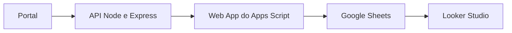
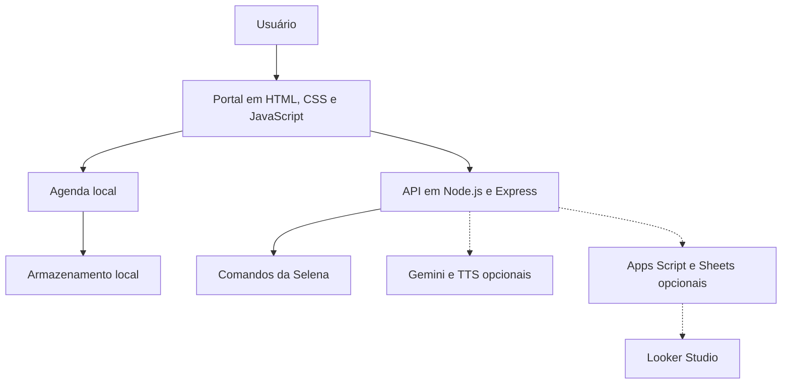
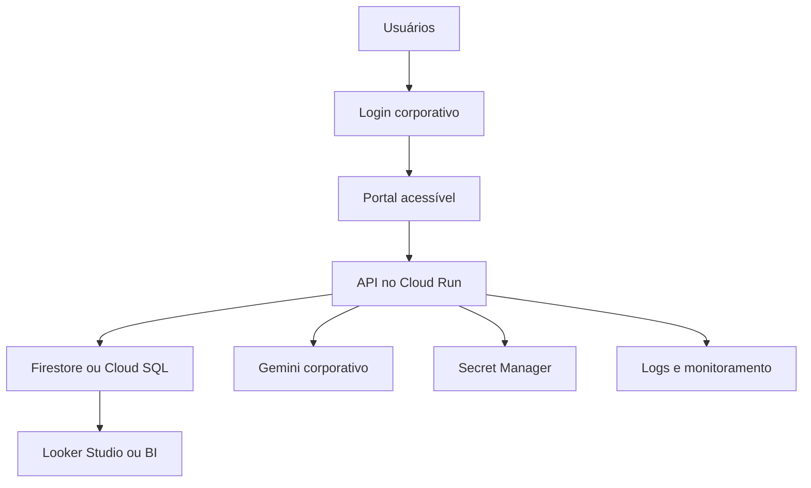

<div align="center">


<br>


# SELENA

### Solução de Escuta, Leitura e Navegação Acessível

**Uma reserva. Três experiências. Um único fluxo.**

Prova de conceito criada para dar autonomia aos profissionais de massoterapia com deficiência visual, facilitar o acesso dos colaboradores ao benefício e oferecer ao RH informações confiáveis sobre a operação.


### [▶ Acessar a demonstração da Selena](https://espaco-saude-semantix.ai.studio)

</div>

> [!IMPORTANT]
> A Selena é um **protótipo demonstrativo validado**, e não um sistema implantado em produção. Os acessos, horários, reservas e avaliações desta versão são fictícios ou anonimizados. Uma implantação real exige autenticação corporativa, revisão de segurança e privacidade, auditoria de acessibilidade, dimensionamento de infraestrutura e contratação das licenças aplicáveis.

> [!NOTE]
> Esta é uma **versão pública de portfólio**. Nomes de participantes, comentários, endereços, contatos, resultados de campanhas e documentos internos foram removidos ou substituídos por dados fictícios. O projeto não representa um sistema oficial da organização onde o desafio foi desenvolvido. Marcas de terceiros pertencem aos seus respectivos titulares e sua presença não implica parceria ou endosso.

## Sumário

1. [Visão geral](#visão-geral)
2. [O problema](#o-problema)
3. [Como investigamos](#como-investigamos)
4. [A solução](#a-solução)
5. [Públicos e jornadas](#públicos-e-jornadas)
6. [O que funciona hoje](#o-que-funciona-hoje)
7. [Como a Selena funciona](#como-a-selena-funciona)
8. [Agenda, Google Sheets e Apps Script](#agenda-google-sheets-e-apps-script)
9. [Indicadores e Looker Studio](#indicadores-e-looker-studio)
10. [Arquitetura técnica](#arquitetura-técnica)
11. [Acessibilidade](#acessibilidade)
12. [Segurança, privacidade e LGPD](#segurança-privacidade-e-lgpd)
13. [Como executar](#como-executar)
14. [APIs do projeto](#apis-do-projeto)
15. [Testes e validação](#testes-e-validação)
16. [Implantação futura](#implantação-futura)
17. [Softwares, licenças e custos recorrentes](#softwares-licenças-e-custos-recorrentes)
18. [Estimativa do projeto](#estimativa-do-projeto)
19. [Roadmap](#roadmap)
20. [Limitações conhecidas](#limitações-conhecidas)
21. [Estrutura do repositório](#estrutura-do-repositório)
22. [Equipe](#equipe)

## Visão geral

A Selena nasceu no Desafio do Programa de Estágio 2026 a partir de uma pergunta simples:

> **Se a agenda é do profissional, por que ele precisa pedir para outra pessoa consultá-la?**

O projeto começou com o objetivo de ampliar a autonomia dos massoterapeutas com deficiência visual, mas a pesquisa mostrou que a falta de acesso à agenda era apenas a ponta do iceberg. O processo inteiro estava concentrado na recepção: divulgação, agendamento, cancelamento, comunicação de alterações e repasse de informações ao RH.

A proposta reconstrói essa experiência como uma jornada integrada do Espaço Saúde. O portal reúne conteúdos, campanhas, benefícios e massoterapia; a Selena oferece navegação acessível por texto e voz; a agenda organiza a operação; e os dados gerados permitem acompanhar o benefício com mais clareza.

## O problema

O fluxo atual cria dependências para todos os envolvidos:

- **massoterapeuta:** precisa perguntar à recepção quais são os próximos atendimentos e se houve alterações;
- **colaborador:** depende da recepção para conhecer o benefício, agendar, cancelar ou pedir orientação;
- **RH e Espaço Saúde:** dependem de registros distribuídos para acompanhar adesão, faltas, cancelamentos, ocupação e satisfação;
- **recepção:** concentra solicitações e informações de um processo que poderia ser mais autônomo;
- **pessoas com deficiência visual:** enfrentam barreiras digitais e físicas até mesmo para consultar a própria rotina.

Na investigação, identificamos três lacunas principais:

1. pessoas que não conheciam a massoterapia ou não sabiam como acessar o benefício;
2. baixa rastreabilidade dos resultados — havia apenas um volume consolidado, sem uma visão completa de atendimentos, faltas, cancelamentos e avaliações;
3. ausência de uma experiência acessível de ponta a ponta, incluindo orientação física até a sala e equipamento dedicado para consulta da agenda.

## Como investigamos

O projeto foi construído a partir de pesquisa com as pessoas e áreas envolvidas. O trabalho incluiu:

- entrevistas com massoterapeutas de Londrina e São Paulo;
- formulário com colaboradores;
- levantamento dos dados disponíveis com o RH;
- observação da sala e da rota física até a massoterapia;
- mapeamento da jornada atual e dos pontos de dependência da recepção;
- prototipação dos fluxos do colaborador, do massoterapeuta e do RH;
- testes do portal, da Selena, do microfone e dos comandos por voz;
- validação da proposta de equipamentos e acessibilidade física.

A validação final do protótipo foi realizada com profissionais participantes, com apoio da equipe do Espaço Saúde. A jornada, a Selena, o site, os equipamentos e a proposta do espaço físico foram aprovados para seguir ao piloto.

> “Essa solução atende não somente a mim, mas aqueles que entrarem e precisarem.”  
> — Profissional A, durante a validação

## A solução

SELENA significa **Solução de Escuta, Leitura e Navegação Acessível**.

A solução possui cinco frentes conectadas:

1. **Portal do Espaço Saúde:** concentra benefícios, campanhas, conteúdos e acesso à massoterapia.
2. **Jornada de agendamento:** permite consultar profissionais e horários, reservar, cancelar, entrar na lista de espera, confirmar chegada e avaliar.
3. **Painel do massoterapeuta:** mostra a agenda e as mudanças de status do atendimento.
4. **Assistente Selena:** oferece apoio por texto, voz e navegação acessível.
5. **Dados para gestão:** registra eventos operacionais que podem alimentar relatórios no Looker Studio.

O objetivo não é substituir o atendimento humano. É retirar o atrito operacional e garantir que colaborador, massoterapeuta e RH tenham a informação de que precisam, no momento certo e em um formato acessível.

## Públicos e jornadas

| Público | Necessidade | Experiência proposta |
| --- | --- | --- |
| **Colaborador** | Descobrir e utilizar o benefício sem depender da recepção | Conhecer a massoterapia, escolher profissional e horário, reservar, cancelar, entrar na lista de espera, confirmar chegada, receber orientação e avaliar |
| **Massoterapeuta** | Consultar a própria rotina com autonomia | Acessar a agenda, ouvir compromissos, consultar o próximo atendimento e acompanhar alterações por texto ou voz |
| **RH / Espaço Saúde** | Acompanhar a operação e tomar decisões com dados | Visualizar adesão, ocupação, atendimentos, faltas, cancelamentos, avaliações e evolução por unidade |
| **Recepção** | Reduzir solicitações repetitivas | Deixar de ser o único ponto de acesso à informação e atuar apenas nas exceções que realmente exigem apoio humano |

### Jornada do colaborador

1. entra no Espaço Saúde;
2. conhece o benefício;
3. escolhe o massoterapeuta, a data e o horário;
4. confirma a reserva ou registra interesse na lista de espera;
5. cancela quando necessário;
6. recebe orientação até a sala;
7. confirma a chegada;
8. avalia o atendimento concluído.


### Jornada do massoterapeuta

1. acessa o painel profissional;
2. consulta ou ouve a agenda;
3. identifica o próximo atendimento e alterações;
4. acompanha chegada, início, conclusão ou falta;
5. utiliza a Selena para navegar e obter respostas operacionais.


### Jornada do RH

1. acompanha indicadores consolidados;
2. identifica adesão, gargalos e ociosidade;
3. compara unidades, profissionais e períodos;
4. avalia satisfação e necessidade de comunicação;
5. toma decisões de melhoria e expansão com base em evidências.

## O que funciona hoje

| Entrega | Status | Funcionamento atual |
| --- | :---: | --- |
| Portal do Espaço Saúde | ✅ | Reúne mural, campanhas, benefícios, conteúdos e massoterapia |
| Perfis de colaborador e massoterapeuta | ✅ Demo | Acessos ilustrativos com perfis de demonstração; não são login corporativo |
| Agendamento e cancelamento | ✅ | Funcionam localmente e podem usar a integração compartilhada opcional |
| Limite semanal | ✅ | Regra demonstrativa de até duas massagens por semana |
| Lista de espera | ✅ Demo | Entrada, retirada e identificação de vaga disponível |
| Confirmação de chegada | ✅ | Registra a chegada do colaborador na jornada demonstrativa |
| Status do atendimento | ✅ | Chegada, em atendimento, realizado, falta e cancelamento |
| Avaliação | ✅ | Nota de 1 a 5 e comentário após atendimento concluído |
| Painel do massoterapeuta | ✅ | Exibe a agenda e as reservas do perfil profissional |
| Selena por texto | ✅ | Comandos essenciais locais e perguntas livres via Gemini |
| Selena por voz | ✅ Parcial | Reconhecimento pelo navegador; a voz natural depende do Gemini TTS |
| Tradução | ✅ Parcial | Dicionário local em PT, EN e ES; expansão opcional por Gemini |
| Orientação até a sala | ✅ Demo | Mapa e instruções em etapas para demonstrar a rota acessível |
| Google Sheets + Apps Script | 🧩 Opcional | Fonte compartilhada para um piloto controlado |
| Dashboard do RH no Looker Studio | 🧭 Proposta | Indicadores e modelo de dados definidos; painel não está incluído neste repositório |
| Autenticação corporativa | 🧭 Futuro | Requer Google Identity/Workspace ou provedor corporativo equivalente |
| Libras | 🧭 Futuro | Evolução a ser cocriada e validada com pessoas surdas |

## Como a Selena funciona

A Selena usa uma arquitetura híbrida para que as funções essenciais não dependam totalmente da IA generativa.

### Ativação, comandos e contexto

Para reduzir ativações acidentais, a escuta considera frases iniciadas por “Selena”, “Oi, Selena” ou “Ei, Selena”. O reconhecimento de fala utiliza os recursos disponíveis no navegador e seu suporte varia conforme navegador, sistema, microfone e permissões.

Perguntas operacionais importantes possuem respostas locais, por exemplo: “Como está minha agenda?”, “Quem é o próximo atendimento?”, “Como faço para cancelar?”, “Como chego até a sala?” e “Quantas massagens posso marcar por semana?”. Esses comandos usam o contexto do perfil e da agenda carregada, mantendo a demonstração útil mesmo sem a API de IA.

### Gemini, áudio e tradução

Quando `GEMINI_API_KEY` está configurada, perguntas livres são enviadas ao backend e processadas pelo Google Gemini. A chave permanece no servidor. A IA recebe um contexto limitado ao papel da Selena: ela não deve inventar reservas, alterar dados diretamente nem responder como profissional de saúde.

O endpoint de TTS tenta gerar voz natural com Gemini. Se estiver indisponível, o portal pode usar a síntese do próprio navegador. Os textos essenciais possuem tradução local para português, inglês e espanhol; com `GEMINI_TRANSLATION_ENABLED=true`, conteúdos adicionais podem ser traduzidos pelo backend.

## Agenda, Google Sheets e Apps Script

O protótipo possui dois modos de agenda.

### Modo local

É o modo padrão para uma demonstração pública. Reservas, cancelamentos, avaliações e lista de espera ficam no `localStorage` do navegador. Ele não sincroniza dispositivos diferentes.

### Modo compartilhado opcional

Para um piloto controlado, o servidor pode encaminhar as operações para um Web App do Google Apps Script, que grava em uma planilha Google Sheets. A integração só é ativada quando as variáveis necessárias estão configuradas no servidor.



### Arquivo `Agenda_MVP_Apps_Script.gs`

O arquivo deve ser copiado para **Extensões → Apps Script** dentro da planilha do piloto. Ele:

- cria e valida um token privado nas Propriedades do Script;
- lê vagas, reservas e lista de espera;
- cria reservas, altera status, cancela, confirma chegada e registra avaliações;
- mantém um histórico de eventos;
- usa `LockService` para reduzir conflitos simultâneos;
- trata células como texto para reduzir risco de injeção de fórmulas;
- valida datas, horários, profissionais, estados e limites antes de gravar.

### Ações aceitas pelo Apps Script

| Ação | Finalidade |
| --- | --- |
| `list` | Retorna vagas, reservas, lista de espera e versão da jornada |
| `reserve` | Reserva um horário livre |
| `update` | Atualiza chegada, início, conclusão, falta ou cancelamento |
| `rate` | Registra nota e comentário de uma reserva concluída |
| `arrival` | Confirma a chegada do colaborador |
| `wait_join` | Inclui interesse em uma data sem vaga |
| `wait_leave` | Retira o interesse da lista de espera |

### Abas esperadas no Google Sheets

| Aba | Responsabilidade | Principais informações |
| --- | --- | --- |
| `Agenda_MVP` | Estado atual dos horários | data, unidade, profissional, início/fim, status, reserva, colaborador demo, avaliação e atualização |
| `Agenda_MVP_Eventos` | Histórico das mudanças | evento, status anterior/novo, reserva, horário, unidade, profissional e data |
| `Agenda_MVP_Espera` | Lista de espera | data, unidade, profissional, participante demo, status e atualização |

O Sheets é adequado para um piloto pequeno porque é conhecido pela equipe, permite inspeção rápida e conecta-se facilmente ao Looker Studio. Ele não deve ser o banco definitivo: possui cotas, não é uma base transacional de alto volume, requer cuidados de concorrência e pode sofrer alterações manuais. As cotas variam por conta e podem mudar: [documentação oficial](https://developers.google.com/apps-script/guides/services/quotas).

## Indicadores e Looker Studio

O Looker Studio foi pensado como a camada visual para o RH e o Espaço Saúde. Ele não executa agendamentos: transforma os registros do Sheets ou do banco futuro em indicadores.

### Indicadores recomendados

- reservas, atendimentos, cancelamentos e faltas;
- taxas de comparecimento, no-show e ocupação;
- adesão por unidade, profissional, dia e faixa de horário;
- tempo entre reserva e atendimento;
- nota média e distribuição das avaliações;
- temas recorrentes nos comentários;
- demanda não atendida e lista de espera;
- evolução antes e depois de campanhas.

As fontes previstas são `Agenda_MVP`, `Agenda_MVP_Eventos`, `Agenda_MVP_Espera` e dados agregados de unidades e colaboradores. O **Looker Studio sem custo** pode atender ao piloto. Para governança, espaços de equipe e suporte corporativo, deve ser avaliado o **Looker Studio Pro**, licenciado para quem cria, edita ou gerencia conteúdo Pro. Consulte a [visão geral](https://cloud.google.com/looker/docs) e a [assinatura Pro](https://cloud.google.com/looker/docs/studio-pro-subscription-overview).

## Arquitetura técnica

### Arquitetura do protótipo



| Camada | Tecnologia | Papel |
| --- | --- | --- |
| Interface | HTML5, CSS3 e JavaScript | Portal, jornada e controles acessíveis |
| Backend | Node.js + Express | APIs, proteção de chaves, IA e agenda |
| IA | Google Gemini | Perguntas livres, TTS e tradução opcional |
| Voz | Web Speech API + Gemini TTS | Entrada por fala e resposta em áudio |
| Persistência demo | `localStorage` | Demonstração sem infraestrutura externa |
| Agenda compartilhada | Google Sheets | Fonte de dados para piloto controlado |
| Automação | Google Apps Script | Regras e gravação da agenda |
| Indicadores | Looker Studio | Visualização para RH |
| Prototipação | Google AI Studio | Experimentação da Selena |
| Clima | Open-Meteo | Informação complementar sem chave própria |
| Testes | Node.js Test Runner | Verificação das regras principais |

### Arquitetura recomendada para produção



Em produção, o Sheets deixa de ser a fonte transacional principal. O banco definitivo deve oferecer concorrência, autorização, auditoria, backup, recuperação e desempenho compatíveis com o volume real.

## Acessibilidade

A acessibilidade foi tratada como requisito de produto.

### Recursos digitais presentes

- navegação por teclado e foco visível;
- alto contraste e ampliação de texto;
- conteúdo em texto e áudio;
- linguagem simples e mensagens de erro orientativas;
- alternativas visuais e comandos por texto como alternativa à voz;
- controles essenciais em português, inglês e espanhol;
- mapa e orientação em etapas.

### Referências utilizadas

- Lei Brasileira de Inclusão, especialmente o art. 63;
- WCAG 2.2 nível AA como referência digital;
- ABNT NBR 9050 para acessibilidade física;
- ABNT NBR 16537 para sinalização tátil no piso.

> [!NOTE]
> Usar essas normas como referência não significa certificação. A conformidade exige auditoria, evidências, testes e correções. Rota, piso tátil, Braille, mobiliário e instalação devem ser dimensionados por profissionais habilitados e validados com pessoas com deficiência.

### Estrutura física proposta

- monitor touch em altura e posição adequadas;
- microfone de mesa com haste flexível;
- teclado fixado em prateleira compacta para uso em pé;
- rota acessível, piso tátil e sinalização das salas em Braille e relevo;
- circulação desobstruída e organização previsível;
- testes com os massoterapeutas antes da implantação.

O suporte em Libras é um próximo passo, não uma funcionalidade pronta. Deve ser desenhado com pessoas surdas e especialistas, podendo combinar vídeos em Libras para conteúdos fixos, atendimento humano e tecnologias validadas.

## Segurança, privacidade e LGPD

O protótipo não armazena prontuários nem dados clínicos. Ainda assim, agenda, identidade e avaliações podem ser dados pessoais.

### Princípios

- coletar somente o necessário;
- explicar a finalidade de cada dado;
- separar acessos de colaborador, massoterapeuta e RH;
- manter chaves e tokens apenas no servidor;
- registrar eventos auditáveis;
- priorizar relatórios agregados;
- definir retenção e descarte;
- informar as pessoas sobre o tratamento dos dados.

### Antes da produção

- autenticação corporativa e autorização por papel;
- HTTPS, gestão de segredos e revisão de vulnerabilidades;
- limites de requisição e proteção contra abuso;
- política de privacidade, base legal e inventário de dados;
- trilha de auditoria, backup e recuperação;
- processo de incidentes;
- aprovação das áreas de Segurança, Jurídico e Privacidade.

## Como executar

### Pré-requisitos

- Node.js 20 ou superior;
- npm;
- navegador atualizado;
- chave Gemini somente para perguntas livres, tradução por IA e voz natural.

```bash
git clone https://github.com/nearbykatayama/portal-selena-bem-estar.git
cd portal-selena-bem-estar
npm install
cp .env.example .env
npm run dev
```

Abra [http://localhost:3000](http://localhost:3000). Sem a chave Gemini, o portal, o agendamento local e os comandos essenciais da Selena continuam funcionando.

### Variáveis de ambiente

| Variável | Obrigatória? | Uso |
| --- | :---: | --- |
| `PORT` | Não | Porta do servidor; padrão `3000` |
| `GEMINI_API_KEY` | Não | Perguntas livres, TTS e IA |
| `GEMINI_TRANSLATION_ENABLED` | Não | Ativa tradução ampliada |
| `SHEETS_DEMO_WRITE_ENABLED` | Não | Ativa o modo compartilhado |
| `SHEETS_APPS_SCRIPT_URL` | Não | URL privada do Web App |
| `SHEETS_APPS_SCRIPT_TOKEN` | Não | Token salvo nas Propriedades do Script |
| `SHEETS_SPREADSHEET_ID` | Não | ID da planilha na alternativa direta |
| `SHEETS_SERVICE_ACCOUNT_JSON` | Não | Credencial de conta de serviço no servidor |

> [!WARNING]
> Nunca publique `.env`, tokens, chaves, credenciais, URLs internas, IDs privados ou dados pessoais.

## APIs do projeto

| Método e rota | Responsabilidade |
| --- | --- |
| `GET /api/demo-agenda/mode` | Informa se a agenda compartilhada está conectada |
| `GET /api/demo-agenda` | Lista agenda, reservas e espera |
| `POST /api/demo-agenda/reserve` | Cria reserva |
| `POST /api/demo-agenda/status` | Atualiza status |
| `POST /api/demo-agenda/rating` | Registra avaliação |
| `POST /api/demo-agenda/arrival` | Confirma chegada |
| `POST /api/demo-agenda/waitlist/join` | Entra na espera |
| `POST /api/demo-agenda/waitlist/leave` | Sai da espera |
| `POST /api/selena` | Processa perguntas livres |
| `POST /api/tts` | Gera áudio |
| `POST /api/translate` | Traduz conteúdo |
| `GET /api/weather` | Consulta o Open-Meteo |

## Testes e validação

```bash
npm test
```

A suíte cobre reserva, cancelamento, conflitos, limite semanal, sincronização, Apps Script, espera, chegada, estados, avaliação, ativação da Selena, respostas locais, tradução, controles de interface e orientação física demonstrativa.

Os testes automatizados foram complementados pela validação com usuários reais da operação. Isso não substitui auditorias formais.

## Implantação futura

### 1. Preparar

- confirmar responsáveis de Produto, RH, Segurança, Jurídico e Tecnologia;
- revisar critérios de sucesso e acessibilidade;
- criar ambientes de desenvolvimento, homologação e produção;
- configurar contas, faturamento e segredos;
- preparar sala, equipamentos, piso e sinalização;
- definir treinamento e suporte.

### 2. Pilotar em Londrina

- instalar monitor, microfone e teclado;
- ativar a agenda compartilhada;
- migrar somente os dados necessários;
- acompanhar adesão, atendimentos, faltas, cancelamentos e avaliações;
- corrigir incidentes e barreiras antes da expansão.

### 3. Tornar produtivo

- substituir acessos demo por login corporativo;
- adotar banco transacional;
- publicar a API no Cloud Run ou equivalente;
- usar Secret Manager, logs, alertas e monitoramento;
- conectar o Looker Studio à fonte governada;
- definir SLA, backup e recuperação.

### 4. Escalar e evoluir

- expandir para São Paulo e outras unidades;
- integrar novos benefícios do Espaço Saúde;
- medir acessibilidade continuamente;
- realizar avaliações periódicas com pessoas com deficiência;
- evoluir a Selena para Libras.

## Softwares, licenças e custos recorrentes

Os valores variam por contrato, região, volume, câmbio e edição. Use as páginas oficiais no momento da contratação.

| Componente | No protótipo | Para implantação | Licença / cobrança |
| --- | --- | --- | --- |
| Node.js, Express e npm | Sim | Manter e revisar dependências | Software aberto; conferir licenças no `package-lock.json` |
| Navegador | Sim | Padronizar versões homologadas | Normalmente já disponível |
| Google AI Studio | Opcional | Experimentação | Uso do estúdio pode ser gratuito |
| Gemini API | Opcional | Perguntas livres e TTS | Faixas gratuita e paga; cobrança por modelo/uso |
| Google Workspace | Conforme ambiente | Identidade, administração e colaboração | Licença por usuário e plano |
| Google Sheets | Opcional | Piloto pequeno | Incluído na conta aplicável; sujeito a limites |
| Google Apps Script | Opcional | Automação do piloto | Sem licença separada; usa conta Google/Workspace e possui cotas |
| Looker Studio | Não incluído no repositório | Dashboard inicial | Versão sem custo disponível |
| Looker Studio Pro | Não | Governança e espaços de equipe | Licenças Pro para criadores/editores/gestores |
| Cloud Run | Não | Hospedagem da API | Pagamento por uso, com faixa gratuita aplicável |
| Firestore ou Cloud SQL | Não | Banco transacional | Cobrança por operações/capacidade, armazenamento e rede |
| Secret Manager | Não | Chaves e tokens | Cobrança por versões e acessos, com faixa gratuita |
| Logging e Monitoring | Não | Logs, métricas e alertas | Conforme ingestão, retenção e recursos |
| Domínio e DNS | Não | URL corporativa | Depende da infraestrutura |
| Equipamentos | Físico | Monitor, microfone, teclado e suportes | Compra/locação; não é licença |
| Acessibilidade física | Físico | Piso, Braille, projeto e instalação | Orçamento específico |
| Auditorias e testes | Validação inicial | Acessibilidade, segurança e privacidade | Serviço interno ou contratado |

Referências oficiais:

- [Google Workspace](https://workspace.google.com/pricing)
- [Gemini API](https://ai.google.dev/gemini-api/docs/pricing)
- [Apps Script — cotas](https://developers.google.com/apps-script/guides/services/quotas)
- [Looker Studio](https://cloud.google.com/looker/docs)
- [Looker Studio Pro](https://cloud.google.com/looker/docs/studio-pro-subscription-overview)
- [Cloud Run](https://cloud.google.com/run/pricing)
- [Firestore](https://cloud.google.com/firestore/pricing)
- [Secret Manager](https://cloud.google.com/secret-manager/pricing)

> [!IMPORTANT]
> A estimativa inicial não inclui automaticamente Workspace, Looker Studio Pro, consumo Gemini, nuvem, banco, monitoramento, domínio, suporte, auditorias ou manutenção. Esses itens dependem da arquitetura e do volume real.

## Estimativa do projeto

Estimativa acadêmica elaborada em novembro de 2026; não é proposta comercial.

### Equipe e esforço do MVP

| Frente | Horas | Valor de referência |
| --- | ---: | ---: |
| Desenvolvimento | 130 h | R$ 5.226,00 |
| UX e acessibilidade | 70 h | R$ 2.814,00 |
| **Total** | **200 h** | **R$ 8.040,00** |

Premissa: **R$ 40,20/hora**.

### Infraestrutura física estimada

| Item | Quantidade aproximada | Observação |
| --- | ---: | --- |
| Monitor touch de 22" | 2 | Estações dos massoterapeutas |
| Microfone de mesa | 2 | Uso em pé |
| Piso tátil direcional e de alerta | Cerca de 160 placas | Confirmar em projeto de rota acessível |
| Sinalização em Braille | 20 placas | Validar conteúdo e instalação |

Estimativa física de referência: **aproximadamente R$ 7.285,20**, antes de frete, instalação, suportes, obras, projeto técnico e variações de fornecedor.

### Consolidado

- desenvolvimento: **R$ 8.040,00**;
- equipamentos e sinalização: **R$ 7.285,20**;
- investimento inicial estimado: **R$ 15.325,20**;
- licenças, nuvem, auditorias e manutenção futura: **não incluídas**.

O ROI deve ser recalculado após o piloto com dados reais de tempo economizado, atendimentos, faltas, cancelamentos, adesão e manutenção.

## Roadmap

| Etapa | Período de referência | Resultado esperado |
| --- | --- | --- |
| **1. Validar** | concluída em nov/2026 | Jornada, Selena, equipamentos e proposta física aprovados |
| **2. Pilotar, medir e ajustar** | jan–jun/2027 | Instalação em Londrina, treinamento, medição e correções |
| **3. Escalar e evoluir** | a partir de jul/2027 | Novas unidades, benefícios, automações, acessibilidade e Libras |

A Selena só deve avançar de etapa depois de demonstrar que funciona de maneira acessível, segura, útil e sustentável.

## Limitações conhecidas

- perfis de acesso demonstrativos;
- modo local sem sincronização entre dispositivos;
- Apps Script adequado somente para piloto pequeno;
- dashboard do Looker Studio não incluído neste repositório;
- IA e voz natural dependem de serviços externos;
- voz varia por navegador e sistema;
- sem certificação WCAG ou ABNT;
- rota física depende de projeto presencial;
- Libras ainda não implementada;
- sem SLA, alta disponibilidade ou recuperação de desastre;
- sem integração produtiva com calendário corporativo;
- dados reais exigem aprovação e controles adequados.

## Estrutura do repositório

```text
.
├── index.html                       # Interface principal
├── style.css                        # Estilos e acessibilidade visual
├── script.js                        # Navegação do portal
├── booking.js                       # Agendamento
├── demo-agenda.js                   # Agenda local
├── server.js                        # API Node.js/Express
├── Agenda_MVP_Apps_Script.gs        # Automação opcional do Sheets
├── apps-script-agenda.js            # Cliente do Web App
├── sheets-agenda.js                 # Alternativa servidor/Sheets
├── i18n.js                          # Internacionalização
├── translation-service.js           # Tradução via backend
├── translation-fallback.js          # Dicionário local
├── wayfinding.js                    # Orientação física
├── waitlist-rules.js                # Lista de espera
├── assets/                          # Imagens, logos, ícones e fontes
├── data/                            # Dados agregados demo
├── tests/                           # Testes automatizados
├── .env.example                     # Modelo seguro de variáveis
└── package.json                     # Dependências e comandos
```

## Minha atuação no projeto

Atuei como **Scrum Master e integradora da solução**, conectando negócio, experiência, acessibilidade e tecnologia. Coordenei as entregas, participei da pesquisa e do mapeamento das jornadas, refinei requisitos, construí fluxos, defini o comportamento esperado da Selena, integrei as partes do protótipo, organizei testes e validações e estruturei a narrativa e a viabilidade da proposta.

## Equipe

Projeto desenvolvido por uma equipe multidisciplinar durante um desafio corporativo de inovação.

- **Alicia Faria** — Scrum Master, coordenação, jornada e integração;
- **Equipe do projeto** — planejamento, custos, governança, dados, testes e validação das funcionalidades com IA.

Os demais nomes foram omitidos desta versão pública por privacidade. Agradecemos às pessoas que participaram das entrevistas, validações e mentorias.

## Uso e autorização

Este repositório é apresentado exclusivamente como demonstração de portfólio. **Nenhuma licença aberta é concedida neste momento.** Antes de reutilizar, distribuir ou implantar o código, confirme a titularidade dos materiais e obtenha as autorizações necessárias. Não publique novamente dados corporativos, nomes de participantes, comentários, documentos, endereços, contatos, credenciais ou marcas sem consentimento.

## Status

**Versão documentada:** revisão de portfólio do protótipo validado — novembro de 2026.

Este repositório demonstra pesquisa, visão de produto, acessibilidade, automação, viabilidade e aplicação de IA generativa em um problema operacional real.

---

Desenvolvido com propósito, pesquisa e colaboração por **Alicia Faria e equipe**.

[GitHub de Alicia](https://github.com/nearbykatayama)
